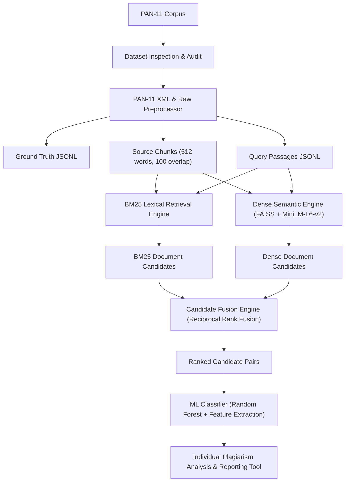

# Hybrid Lexical-Semantic Plagiarism Detection for Academic Documents Using Dual Retrieval and Candidate Fusion

A research prototype for plagiarism detection in academic documents built on the **PAN-11 Plagiarism Corpus (PAN-PC-11)** external detection dataset.

## System Architecture



---

## Directory Structure

```
pan-plagiarism-corpus-2011/
│
├── config.yaml                     # Pipeline configuration (chunk size, models, top_k, rrf_k)
├── requirements.txt                # Python package dependencies
├── README.md                       # Project documentation and reproducibility guide
│
├── src/
│   ├── preprocessing/
│   │   ├── pan_parser.py           # XML parser for PAN-11 ground truth annotations
│   │   ├── document_loader.py      # Raw document loader preserving exact character offsets
│   │   ├── ground_truth.py         # Ground truth & retrieval query record builder
│   │   └── chunker.py              # Word sliding-window chunker with character span tracking
│   │
│   ├── retrieval/
│   │   ├── bm25_retriever.py       # BM25 lexical search engine
│   │   ├── dense_retriever.py      # SentenceTransformer + FAISS semantic search engine
│   │   └── candidate_fusion.py     # Document-level Reciprocal Rank Fusion (RRF)
│   │
│   ├── classification/
│   │   ├── feature_extractor.py    # 10-D Feature extraction pipeline
│   │   └── train_classifier.py     # Random Forest / Gradient Boosting pipeline
│   │
│   ├── evaluation/
│   │   ├── retrieval_metrics.py    # Recall@K and MRR metrics
│   │   └── evaluate.py             # Evaluation script for candidate fusion results
│   │
│   └── utils/
│       ├── config.py               # YAML configuration loader
│       └── logging_utils.py        # Stream and file logger setup
│
├── scripts/
│   ├── inspect_dataset.py          # Complete dataset audit and validation report tool
│   ├── preprocess_pan11.py         # Corpus parser and chunking preprocessor
│   ├── build_bm25_index.py         # BM25 index builder
│   ├── build_dense_index.py        # Dense FAISS index builder
│   ├── run_experiment.py           # Full retrieval & evaluation experiment runner
│   ├── train_and_evaluate_classifier.py # ML Model trainer & pickle exporter
│   ├── detect_plagiarism.py        # Individual File Plagiarism Detection Tool
│   └── evaluate.py                 # Candidate fusion standalone evaluator
│
├── tests/
│   ├── test_pan_parser.py          # Unit tests for XML annotation parsing
│   ├── test_chunking.py            # Unit tests for character-span preserving chunker
│   ├── test_rrf.py                 # Unit tests for candidate fusion logic
│   ├── test_evaluation.py          # Unit tests for Recall@K and MRR evaluation
│   └── test_classifier_pickle.py   # Unit tests for pickle model deserialization
│
├── data/
│   ├── processed/                  # Parsed ground truth, queries, document & chunk JSONLs
│   └── indexes/                    # Saved BM25 pickle & Dense FAISS index files
│
└── outputs/
    ├── reports/                    # Dataset validation JSON & TXT reports
    ├── trained_plagiarism_classifier.pkl # Exported ML Model Pickle File
    ├── classification_report.json  # Classification metrics report
    ├── candidate_fusion_results.jsonl # Top candidate retrieval records
    └── results.csv                 # Comparative retrieval metrics table
```

---

## Individual File Plagiarism Detection Tool

You can test any **individual document** or **text string** against the entire indexed corpus to find matching source references, model confidence, and overlapping text snippets!

### 1. Check an Individual Text File:
```bash
python scripts/detect_plagiarism.py --input "path/to/my_academic_document.txt" --top-k 5
```

### 2. Check a Raw Text Passage Input:
```bash
python scripts/detect_plagiarism.py --text "Paste your text passage here..." --top-k 5
```

### 3. Save Analysis Report to JSON File:
```bash
python scripts/detect_plagiarism.py --input "path/to/my_paper.txt" --output-report "outputs/my_paper_detection_report.json"
```

---

## Sample Detection Report Output

```
======================================================================
PLAGIARISM DETECTION ANALYSIS REPORT
======================================================================
Input Document     : suspicious-document00007.txt
Character Length   : 2000 chars
Word Count         : 351 words
Overall Verdict    : PLAGIARISM DETECTED
----------------------------------------------------------------------
TOP MATCHED SOURCE DOCUMENTS:
----------------------------------------------------------------------
Match #1: source-document06022.txt
  - Decision           : PLAGIARISM_MATCH
  - Model Confidence   : 100.00%
  - Fused Rank         : 1
  - BM25 Score         : 454.646
  - Dense Similarity   : 0.842
  - Word Overlap       : 0.4525
  - Matched Source Text Snippet:
    "I show you three examples of what the Greeks actually did..."
----------------------------------------------------------------------
```
